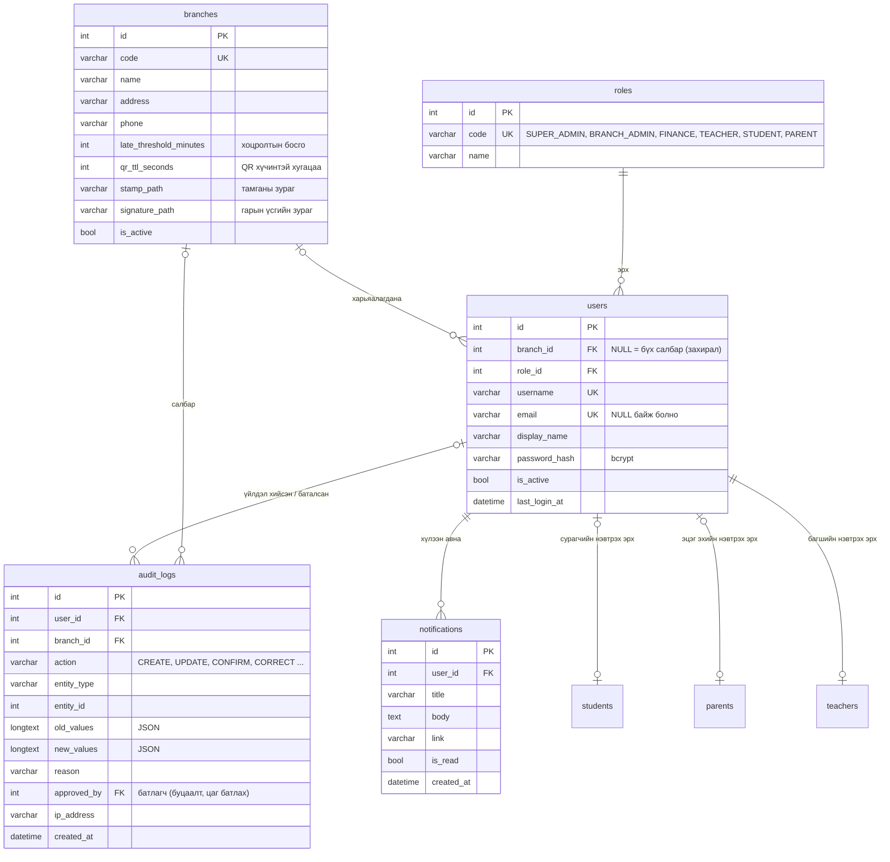
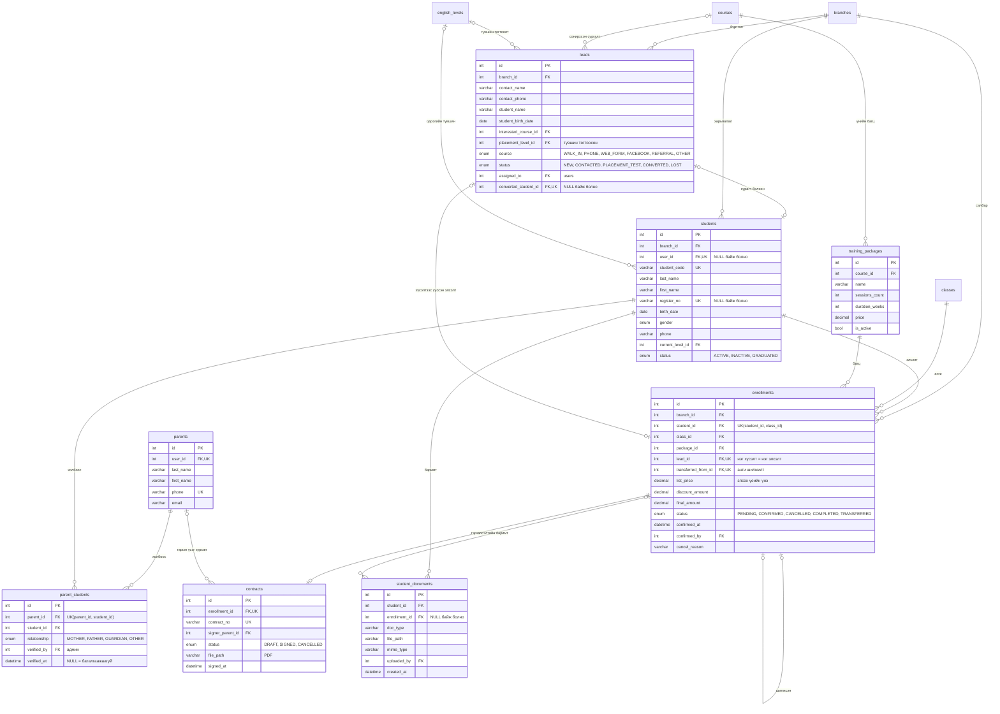
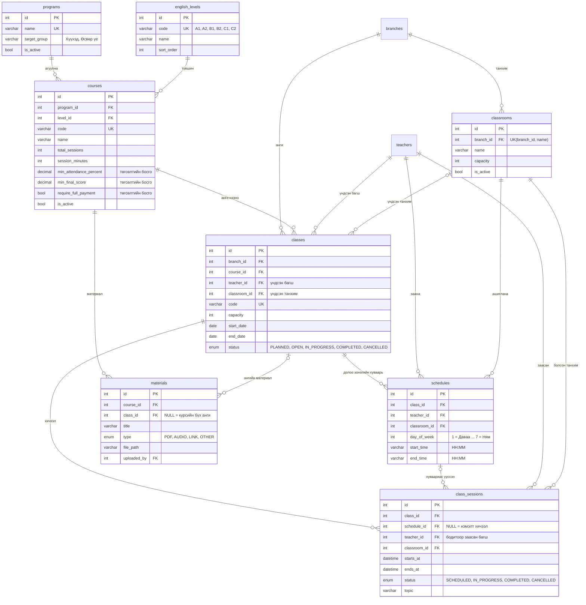
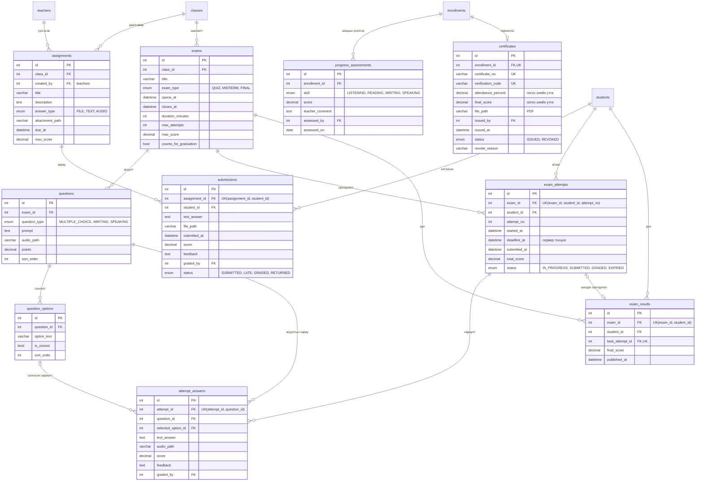
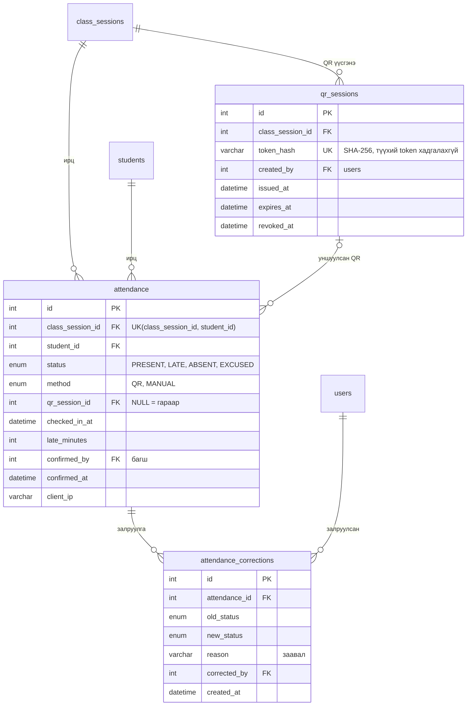
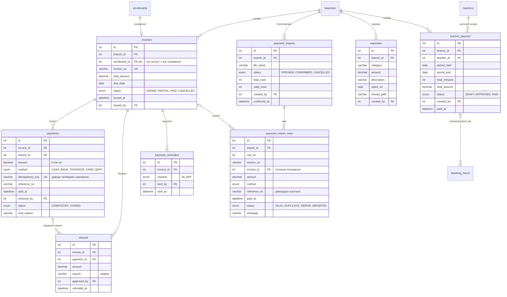
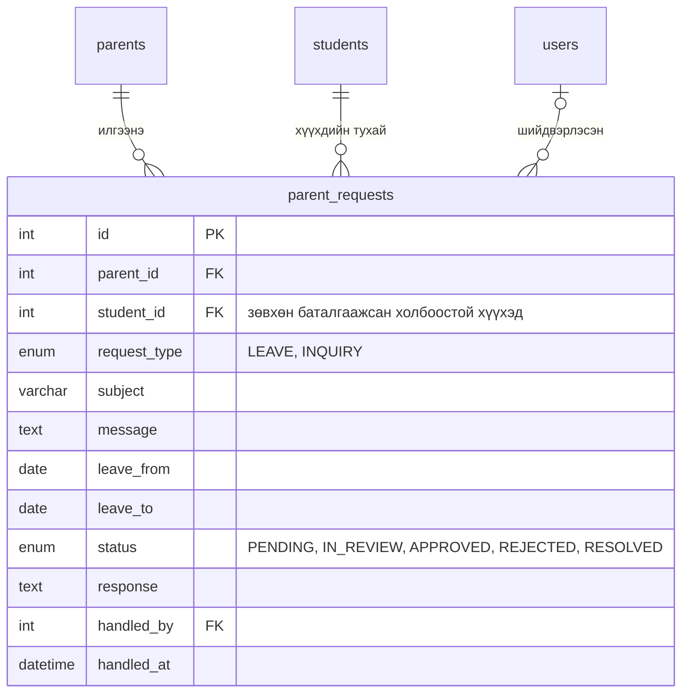
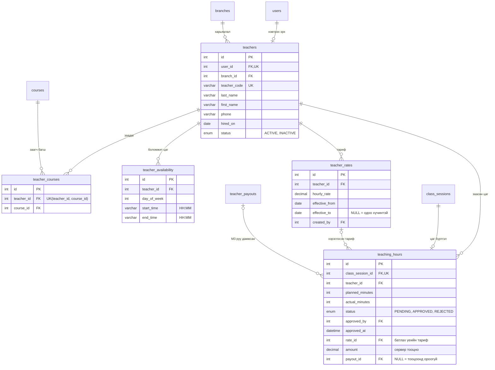

# ER Diagram — Англи хэлний сургалтын төвийн ERP

- Эх сурвалж: SUERP3.docx (7 модуль), Master Prompt §6
- Database: `english_center_erp` · MariaDB 10.4.32 · `utf8mb4_unicode_ci`
- Энэ файл хүснэгт, гол багана, холбоосыг харуулна. Баганын бүрэн тодорхойлолт `backend/prisma/schema.prisma` файлд байна.
- Бүх хүснэгт `created_at`, ихэнх нь `updated_at` баганатай (диаграмд товчилсон).
- Хуваарийн цаг (`start_time`, `end_time`) нь `VARCHAR(5)` "HH:MM" (Asia/Ulaanbaatar). Огноо-цаг бүгд UTC-ээр хадгалагдана.

## Тэмдэглэгээ

- `||--o{` : нэг мөр — тэгээс олон мөр
- `||--o|` : нэг мөр — тэг эсвэл нэг мөр
- `|o--o{` : FK нь NULL байж болно — тэгээс олон мөр
- `PK` : Primary Key, `FK` : Foreign Key, `UK` : Unique
- `UK(a, b)` : хоёр баганын хослол давтагдахгүй
- Мөнгөн дүн бүгд `DECIMAL(12,2)`

---

## 1. M7 — Удирдлага ба салбар (цөм хүснэгтүүд)

---

## 2. M1 — Сурагчийн удирдлага

---

## 3. M4 — Сургалт ба үнэлгээ (хөтөлбөр, анги, хуваарь)

---

## 4. M4 — Сургалт ба үнэлгээ (даалгавар, шалгалт, гэрчилгээ)

---

## 5. M2 — QR ирцийн систем

---

## 6. M3 — Төлбөр ба санхүү

---

## 7. M5 — Эцэг эхийн портал

---

## 8. M6 — Багшийн удирдлага

